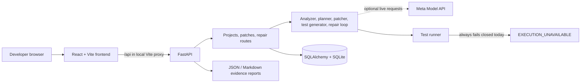

# PatchPilot architecture

PatchPilot is a local FastAPI and React prototype for inspecting a Python project, drafting repair candidates, and recording verification evidence. The current system is not a hosted multi-user repair service.

## Components

- **Frontend:** React 18, TypeScript, Vite and Tailwind. The public-facing information pages are `/`, `/gallery`, `/privacy`, and `/terms`; the working prototype UI is `/work`. Local Vite proxies `/api` to `127.0.0.1:8000`.
- **API:** FastAPI exposes project intake, ZIP upload, files, analysis, repair plans, candidate patches, approval/application, test generation, verification, repair-loop, report, health, provider, public-config and evaluation routes.
- **Repository handling:** project workspaces are stored under the configured data area. ZIP validation checks archive paths, symlinks, size, member count and compression ratio. Static inspection parses Python source; it does not execute source files.
- **Repair services:** localization and static analysis feed structured plans; patch validation checks paths, context and syntax; patches require approval before applying. Regression-test generation and a bounded repair loop are implemented, with live Meta calls optional.
- **Provider:** `MetaClient` calls the Meta Model API using a server-side `MODEL_API_KEY`. Demo responses are explicitly simulated. Live API connectivity has not been verified for this account. Provider call provenance is not yet durably attached to every artifact.
- **Persistence:** SQLAlchemy models cover projects, findings, plans, repairs, patches, generated tests, verification runs and audit events. Tables are initialized with `Base.metadata.create_all` and small compatibility logic; there is no checked-in Alembic migration history.
- **Execution:** `PytestRunner` snapshots project files, but `run_sandboxed_command` currently returns `EXECUTION_UNAVAILABLE` before starting a process. Snapshotting alone is not isolation. There is no Pyodide/browser runner.
- **Evaluation and training:** training data is a small synthetic dataset. The evaluation output is explicitly `NOT_MEASURED`; it is not a measured benchmark.

## Trust boundaries

Browser input and repository contents must be treated as untrusted. In live mode, project context sent for AI analysis leaves the local application and goes to Meta's API. The backend keeps the API key; it is not a frontend setting. A proposed patch is not evidence that tests pass. The frontend reports actual recorded execution state and currently labels execution unavailable.

## Data flow and deployment

For local development, the Vite proxy provides a same-origin `/api` path to FastAPI. `render.yaml` and `backend/Dockerfile` describe a FastAPI deployment, while `frontend/vercel.json` contains the static Vercel SPA/API routing preparation. No public environment or external database has been configured. See [DEPLOYMENT.md](DEPLOYMENT.md) and [docs/DEPLOYMENT.md](docs/DEPLOYMENT.md).
